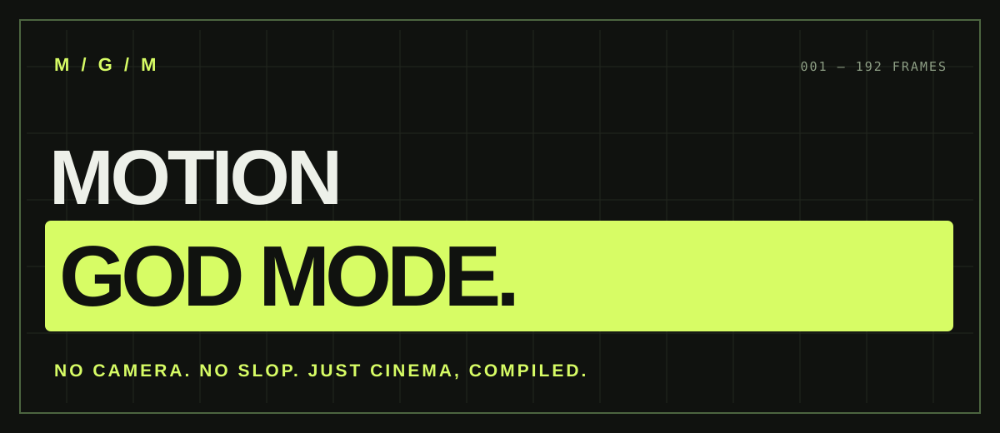
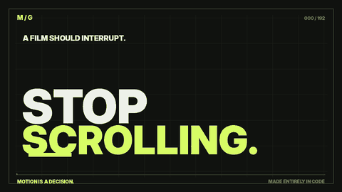

<div align="center">

# MOTION GOD MODE

### NO CAMERA. NO SLOP. JUST CINEMA, COMPILED.

**An open-source director for coding agents. Turn a sentence into a film, not a slideshow.**

[](LICENSE)
[](https://agentskills.io/specification)
[](scripts/validate_project.py)
[](#install)



**[Watch the 8-second film with original audio](media/demo.mp4)** · **[Install](#install)** · **[Read the skill](SKILL.md)**



*192 deterministic frames · Original synthesized soundtrack · Full source and QA included*

</div>

---

## AI video is easy. Directing is hard.

Most agents can animate a rectangle. The hard part is choosing **why it moves**, when it stops, how the next shot inherits its energy, and whether the audio makes it matter.

**MOTION GOD MODE is a portable Agent Skill that makes a coding agent act like a motion director, creative technologist, editor, sound designer and unforgiving reviewer.** Give it a product, a URL, or a one-line idea. It writes the brief, checks sources, pitches creative directions, storyboards by frame, builds code-driven animation, scores and renders, then critiques what it actually made.

It is a **workflow and set of working QA tools**, not a hosted text-to-video model. Quality still depends on the agent, available rendering tools, your assets and the brief. The included demo script renders a reproducible 8-second film with an original synthesized soundtrack.

## Install

**One command:**

```bash
npx skills add Pedroshakoor/Motion-God-Mode
```

This uses the open [Agent Skills](https://agentskills.io/specification) format; it can be used by compatible agents including Codex, Claude Code and Cursor. Agent support and locations differ by client.

**Manual install — Codex / agents using `.agents/skills`:**

```bash
git clone https://github.com/Pedroshakoor/Motion-God-Mode.git
mkdir -p ~/.agents/skills
cp -R motion-god-mode ~/.agents/skills/motion-god-mode
```

**Manual install — Claude Code:**

```bash
git clone https://github.com/Pedroshakoor/Motion-God-Mode.git
mkdir -p ~/.claude/skills
cp -R motion-god-mode ~/.claude/skills/motion-god-mode
```

`SKILL.md` is in the root of the installed skill folder. No account, paid API or video provider is required for the portable directing instructions. Code rendering depends on a working local stack.

## Talk to your agent like a creative director

```text
Use MOTION GOD MODE. Make a 15-second 9:16 launch film for https://myproduct.com.
Audience: impatient indie founders.
End state: they understand the product in one viewing and remember its name.
Keep the actual site branding. No fake reviews, users or performance claims.
Take full creative control; render a real MP4 and show the contact sheet and QA.
```

Or even:

```text
Use MOTION GOD MODE. 8 seconds. Make typography feel alive. No voice.
```

Missing brief fields are intentional: the agent fills them, logs each decision, and keeps moving unless a genuine source/rights blocker stops the work.

## Choose your poison

| Mode | MOTION GOD MODE does | Never does |
| --- | --- | --- |
| `showreel` | One idea mutates through type, shape, UI, depth and one replay-worthy transition | Fake clients, empty effect montages |
| `product` | Real product UI, visible user actions/results, accurate brand and final URL | Generic fake dashboards or static screenshots in motion |
| `launch-story` | Character acting, timing, emotion, surprise and reveal | Characters pointing at floating ad copy |
| `explainer` | One causal idea, precise voice pacing, staged discovery | Slideshow with a narrated transcript |

Use your existing Remotion / React stack, frame-driven HTML/SVG/GSAP, or a custom Python/FFmpeg renderer. The skill favors what **works** in the existing project over forcing a new framework.

## What it actually ships

```text
motion-god-mode/
├── SKILL.md                     ← the installable skill
├── README.md                    ← you are here
├── assets/
│   ├── brief.template.md
│   ├── facts.template.json
│   ├── timeline.template.json
│   ├── creative-ledger.template.md
│   └── asset-ledger.template.md
├── references/
│   ├── directing.md             ← cinematography + timing grammar
│   ├── modes.md                 ← 4 story structures
│   ├── asset-and-claims.md      ← source/rights discipline
│   ├── production.md            ← deterministic frame rendering
│   ├── audio.md                 ← music, dialogue + mixing
│   ├── critique.md              ← blind critic loop + scoring
│   └── release-checklist.md
├── scripts/
│   ├── init_project.py          ← full project skeleton in one command
│   ├── validate_project.py      ← frame math, claim chain, real MP4 inspection
│   ├── contact_sheet.py         ← still/dark/motion diagnostics + visual QA
│   ├── audio_report.py          ← measured LUFS + true peak
│   ├── render_demo.py           ← working 8s film + original soundtrack
│   └── publish.sh               ← create a public GitHub repo from a local copy
├── examples/showreel/          ← real 192-frame storyboard and QA reports
├── media/hero.svg              ← original repo art, no stolen assets
├── media/preview.gif           ← generated when you run the demo locally
├── media/demo.mp4              ← generated when you run the demo locally
└── tests/                      ← 6 built-in contract tests
```

## Run the tools without any AI agent

Python 3.10+, FFmpeg/ffprobe. Pillow is only needed for image contact sheets and the runnable demo:

```bash
python -m pip install Pillow

# 1. Generate an editable film project:
python scripts/init_project.py ./first-film --mode product --duration 15 --aspect 9:16 --fps 60

# 2. Edit first-film/brief.md, first-film/facts.json and first-film/timeline.json.
# 3. Have your agent implement the frame-driven renderer.

# 4. Check the storyboard BEFORE spending time on a full export:
python scripts/validate_project.py ./first-film

# 5. After your renderer writes first-film/output/final.mp4:
python scripts/validate_project.py ./first-film \
  --video ./first-film/output/final.mp4 --json-out ./first-film/output/qa.json
python scripts/contact_sheet.py ./first-film/output/final.mp4 \
  --output ./first-film/output/contact-sheet.jpg --every 0.2
python scripts/audio_report.py ./first-film/output/final.mp4
```

`validate_project.py` refuses off-by-one scene timing, missing video/audio streams, invalid formats, missing claim IDs and **unverified facts** appearing in the film. The contact sheet flags sampled black/still frames for *human review*, not as automatic failure. The audio checker measures actual loudness and true peak; it doesn't pretend to judge music taste. Technical passes are necessary, never sufficient.

### Rebuild the demo

```bash
python scripts/render_demo.py --out media/demo.mp4 --gif media/preview.gif
python scripts/validate_project.py examples/showreel --video media/demo.mp4
python scripts/contact_sheet.py media/demo.mp4 --output media/contact-sheet.jpg
python scripts/audio_report.py media/demo.mp4
python -m unittest discover -s tests -v
```

[Inspect the demo QA](examples/showreel/qa.json) · [See the reproducible film source](scripts/render_demo.py)

The sample is **8 s × 24 fps = 192 frames** at 960 × 540. The locally generated output has an original synthesized soundtrack. This deliberately small reproducible teaser is proof of the code path, not a promise that every future run will create a cinema-grade film unattended.

## The rule that changes everything

> A film with no bugs isn't finished. It's finished when it holds up next to the best work in its genre.

Every run requires an actual render and a critique pass. Each film leaves behind its brief, source-verified claims, exact frame timeline, asset ledger, build source, QA reports, contact sheet and a revision history. If something is missing, the agent must say it is missing.

## Works with the Agent Skills standard

MOTION GOD MODE follows the [Agent Skills specification](https://agentskills.io/specification): YAML metadata, skill entry point, optional execution scripts, and lazily loaded references. The source is inspectable; you can fork the rules, modify the creative bar, or add workflows for another renderer.

## Contributing

Fix an actual visual problem, submit a reproducible improvement, or add a rigorously tested production technique. **No fluff, no template spam.** See [CONTRIBUTING.md](CONTRIBUTING.md).

**Author:** [@Pedroshakoor](https://github.com/Pedroshakoor) · **License:** [MIT](LICENSE)

If MOTION GOD MODE makes your next film better, **star the repository**. A star helps more creative developers find a code-first alternative to generic AI video output.
